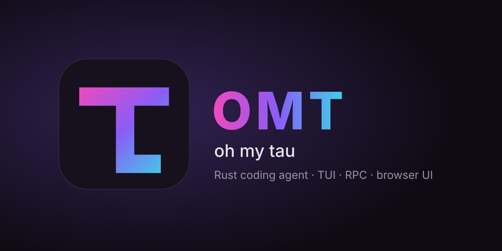
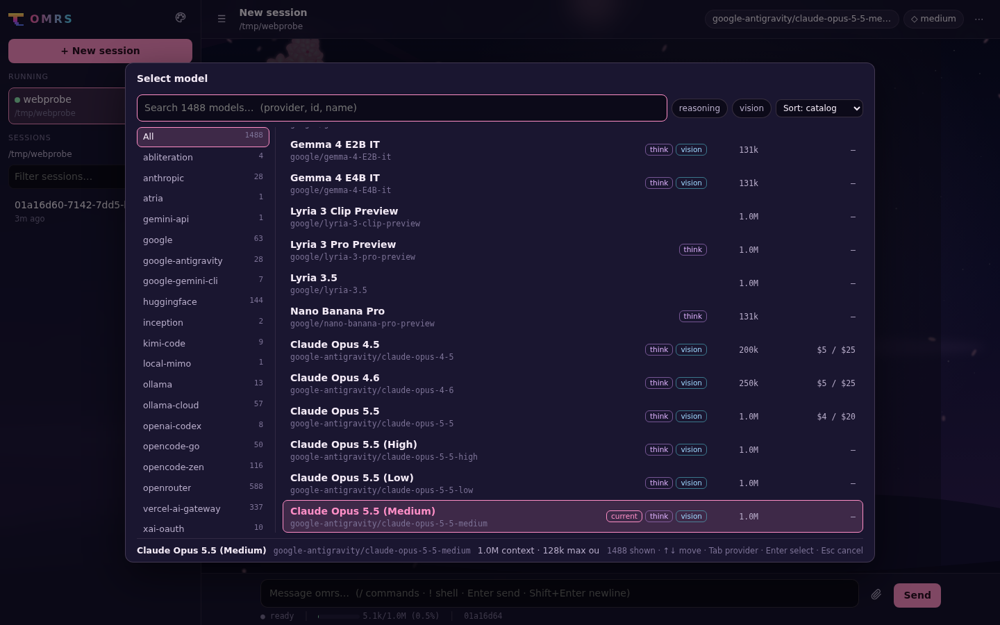

<p align="center"></p>

# τ oh my tau (omt)

**oh my tau** (**omt**) is a Rust port of [oh-my-pi](https://github.com/can1357/oh-my-pi)
("omp"), the TypeScript coding agent. It re-implements the parts of omp that
matter day to day: the interactive TUI, headless print mode, an RPC mode, a
browser UI, and the model/provider/session machinery — reading and writing the
same config and session files as omp, so the two can be used interchangeably
on the same agent directory (`~/.omp/agent`).

The release binary is `omt`. Highlights:

- **TUI** — interactive terminal session with a `/model` browser, autocomplete,
  themes and magic-keyword gradients.
- **Print mode** — `omt -p "prompt"` for one-shot, scriptable runs.
- **RPC mode** — `omt --mode rpc`: newline-delimited JSON-RPC on stdio (each
  browser session below runs as one of these).
- **Browser UI** — `omt web` serves a local web UI (default
  http://127.0.0.1:7467) with themes, wallpapers and per-session agents.
- **Extensions** — runs unmodified omp `ExtensionAPI` extensions through a
  Bun-based extension host (`ext-host/`).
- **MCP** — Model Context Protocol client (stdio and Streamable-HTTP/SSE).
- **LSP** — language-server integration with diagnostics and workspace edits.
- **Sessions** — omp session JSONL (format v3) read/write; `-c`, `-r` and
  `--fork` work on the same sessions omp writes.

It is fast: a one-shot `omt -p` run finishes in about 22 ms of harness time and
uses ~20x less CPU than Pi on Node ([Benchmarks](#benchmarks), provisional).

## Screenshots

The `omt web` browser UI:

| Session | Models | Appearance |
| --- | --- | --- |
|  |  |  |

## Install

Linux x86_64, prebuilt binary (verifies the release's sha256, installs to
`~/.local/bin/omt`; set `OMT_INSTALL_DIR` to change it):

```sh
curl -fsSL https://raw.githubusercontent.com/kanashimi1/oh-my-tau/main/install.sh | sh
```

Or download `omt-linux-x64` from the
[releases](https://github.com/kanashimi1/oh-my-tau/releases), check it against
`SHA256SUMS.txt` and put it on `PATH` as `omt`. Other platforms: build from source.

## Build from source

Requirements:

- A Rust toolchain. The workspace pins no MSRV, but vendored crates use
  edition 2024, so **Rust 1.85+** is required (a recent stable is
  recommended). Check `rustc --version`.
- Optional: [bun](https://bun.sh), needed only to run omp extensions (the
  extension host is a Bun script) and for the golden tests.

```sh
cargo build --release -p omp-cli
```

The binary lands at `target/release/omt`.

## Quick start

omt resolves providers, models and credentials from omp's agent directory
(`$OMP_AGENT_DIR`, default `~/.omp/agent`). Pick whichever of these applies:

1. **Environment API key** — standard per-provider variables are picked up
   automatically, e.g. `ANTHROPIC_API_KEY`, `OPENAI_API_KEY`,
   `GEMINI_API_KEY`, `DEEPSEEK_API_KEY`.

2. **OAuth login** — for providers with an OAuth flow:

   ```sh
   omt login            # pick a provider interactively
   omt login anthropic  # or name one
   ```

   Credentials are stored in `agent.db` (the omp credential store); refresh
   tokens are renewed automatically. `omt logout <provider>` removes them.

3. **models.yml** — custom providers and base-URL overrides in
   `~/.omp/agent/models.yml`:

   ```yaml
   providers:
     my-proxy:
       baseUrl: https://my-proxy.example.com/v1
       apiKey: sk-...        # literal, an env var name, or `!command` output
       api: openai-completions
   ```

Then start a session:

```sh
omt                      # interactive TUI
omt -p "summarize this"  # print mode, exits when done
omt --mode rpc           # JSON-RPC on stdio
omt web                  # browser UI on http://127.0.0.1:7467
```

Useful subcommands (see `omt <sub> --help`): `models`, `stats`, `config`,
`gc`, `export`, `judge-sessions`, `login`/`logout`, `collab`, `serve-collab`,
`web`.

## Key features

- **Slash commands** — `/help`, `/model`, `/effort`, `/compact`, `/session`,
  `/tools`, `/todo`, `/mcp`, `/usage`, `/stats`, `/ultra` and more; extensions
  and file templates can add their own.
- **Ultra modes** — `/ultra code|deep|long|hyper|off` raises the effort level
  past `max`: `ultracode` (workflow workpool on every substantial task),
  `ultradeep` (+ RLM retrieval for huge inputs), `ultralong` (+ CLM context
  strategy for long sessions), `hypercode` (both).
- **Magic keywords** — writing `ultrathink`, `orchestrate`, `workflowz`,
  `jevify` or `ultracode` as a standalone word in a prompt (never inside code
  spans or fences) fires a hidden per-message notice that steers the agent;
  the editor paints each keyword with its gradient.
- **MCP servers** — configured from `~/.omp/agent/mcp.json` and project
  `mcp.json`/`.mcp.json`; tools surface as `mcp__<server>_<tool>`. Inspect
  with `/mcp`.
- **LSP** — language servers from `defaults.json` + user/project
  `lsp.json`/`lsp.yaml`; diagnostics feed the model, edits round-trip.
- **Sessions** — resumable JSONL v3 sessions under `~/.omp/agent/sessions`,
  compatible with omp (`-c` continue newest, `-r [ID]` resume with picker,
  `--fork ID` to branch, `omt export` to HTML).

## Benchmarks

omt was measured with [Buffon](https://github.com/MichaelKinsy/buffon), a harness
benchmark for Pi-family coding agents, against **Pi on Node** (`pi-node`,
`@earendil-works/pi-coding-agent` 1.3.0), Buffon's reference arm.

> **PROVISIONAL.** Measured on a shared WSL2 host (Buffon host class B: other tasks
> may run on the bench CPUs), 6 rounds per cell (Buffon's adaptive stopping; the
> Verified badge needs 12), 2026-10-24, omt v0.10.0. The model is Buffon's mock
> server, so this measures **harness overhead only**, not model quality or task
> success. This is **not** an official Buffon leaderboard entry yet (the `omt` arm
> is submitted upstream). Absolute milliseconds depend on the host; the ratios are
> the meaningful part.

Overhead workloads, `openai-completions` endpoint, medians:

| Metric | omt | Pi on Node | omt / Pi |
|---|---:|---:|---:|
| `--version`, wall time | 6.7 ms | 193 ms | 0.035 |
| `-p`, wall time | 21.9 ms | 291 ms | 0.075 |
| `-p`, time to first model request | 15.8 ms | 269 ms | 0.059 |
| `-p`, CPU time | 18.9 ms | 365 ms | 0.052 |
| `-p`, instructions | 42.4 M | 2,205 M | 0.019 |
| `-p` with tools (9 turns), wall time | 40.3 ms | 364 ms | 0.11 |
| RPC mode, ready time | 13.8 ms | 242 ms | 0.057 |
| RPC mode, exit after stdin closes | 2.3 ms | 11.5 ms | 0.20 |
| RPC, 40 turns, CPU time | 149 ms | 623 ms | 0.24 |
| Streaming, CPU per 1k tokens | 4.5 ms | 46.3 ms | 0.097 |
| Peak RSS (`-p` with tools / RPC) | 55 / 56 MiB | 137 / 148 MiB | 0.40 / 0.38 |
| Install | one 104 MB binary | 110.6 MB + Node 199 MB | |

Peak RSS of a bare `-p` run is about 51 MB (`/usr/bin/time`); Buffon's own sampler
reads ~2 MiB for it because the process exits before it is sampled, so the table
uses the longer workloads, where Buffon's reading is reliable.

### Where omt is worse

| Metric | omt | Pi on Node | omt / Pi |
|---|---:|---:|---:|
| Request bytes per turn, `-p` | 28,387 | 8,932 | 3.18 |
| Request bytes per turn, `-p` with tools | 30,590 | 16,998 | 1.80 |
| Request bytes per turn, RPC | 69,481 | 61,578 | 1.13 |
| RPC, harness-added time per turn | 1.83 ms | 1.17 ms | 1.56 |

Requests are larger because omt keeps omp's system prompt, which is bigger than Pi's
(more input tokens per turn; provider prompt caching absorbs most of the repeat).

### Reliability

Buffon injects faults at the mock (HTTP 429/500, dropped connections, keepalive-only
streams, SIGKILL during a tool call and resume, SIGTERM mid-stream) and compares the
observable outcome with Pi's. omt passes `http-429-retry`, `http-500-retry`,
`keepalive-only`, `kill-mid-tool` and `sigterm-midstream` on both wire APIs. In the
`disconnect-before` / `disconnect-midstream` samples that ran, omt's outcome equals
Pi's; the cells are not scored because the host was too busy for the reference run.
One real difference: when every request is rate-limited, omt retries 10 times (omp's
`retry.maxRetries` default) where Pi gives up after 3, then exits with an error.

Buffon's Pi Harness Score for the families measured (overhead and streaming, 2 of 9)
is 94 (A) for omt against 70 for the reference (provisional; Pi-faithfulness not
measured).

### Reproduce

```sh
git clone https://github.com/MichaelKinsy/buffon && cd buffon
./buffon.sh up --harness omt,pi-node --bench standard
```

(once the `omt` arm is merged upstream; until then, add `arms/omt` from the pending
pull request).

## Adding new models

New models reach omt through three layers; each is optional and later layers
win:

1. **Live refresh** — `omt models --refresh [provider]` (or `F5` in the
   `/model` browser) ports TS `ModelRegistry.refresh`: for every provider
   with a base URL + credential (models.yml `apiKey`/`baseUrl`, env API key,
   or an `agent.db` credential), it fetches `/models` (query string
   preserved), merges with the existing cache, and writes a `models.db`
   `model_cache` row in the exact TS schema — including the
   `materialization_policy` string TS readers gate on (`app-<version>:
   builder-1:rules-<n>-<wyhash of rules.json>`, computed in
   `crates/omp-providers/build.rs` from the vendored TS checkout). Fresh
   rows skip the network for 2 h (TS `BUILT_IN_DISCOVERY_CACHE_TTL_MS`).
   Verify TS still reads Rust-written rows with
   `bun scripts/verify-models-db.ts <models.db> [provider]`.
2. **models.yml** — declare the provider (`baseUrl`, `apiKey`) or pin
   individual models under `providers.<name>.models[]`; `modelOverrides`
   patches apply on top of catalog rows.
3. **Bundled catalog** — `scripts/sync-catalog.sh` regenerates the embedded
   `crates/omp-cli/assets/tui-model-catalog.json` and the pa-ai compat data
   (`vendor/pa-ai/data/compat/{rules,axes}.json`) from a newer
   `vendor-src` checkout (requires bun). Run it after every vendor-src bump
   and rebuild — the rules hash feeds the materialization policy above, so
   stale rules make TS discard the cache.

## Development

```sh
cargo test --release --workspace
```

The golden tests in `tests-golden/` compare Rust behaviour against the
TypeScript implementation; they additionally need bun and a local oh-my-pi
checkout at `vendor-src/oh-my-pi/` (gitignored), and are optional.

omt is a workspace of crates: `omp-cli` (the `omt` binary: TUI, RPC loop
and the `web` browser UI) plus `omp-providers` (model/credential resolution),
`omp-session`, `omp-tui`, `omp-ext`, `omp-mcp`, `omp-lsp` and the other
`omp-*` support crates — layered over the vendored `pa-*`/`pi-*` crates (see
[`NOTICE.md`](NOTICE.md)).

## License

omt is MIT-licensed — see [`LICENSE`](LICENSE). Third-party vendored code is
attributed in [`NOTICE.md`](NOTICE.md).
